<!-- ===================== HEADER ===================== -->

  

  

  
  
  
  

---

<!-- ===================== ABOUT ===================== -->
##  About Me

<table>
<tr>
<td width="55%" valign="top">

I'm a **Machine Learning Engineer** and **Master's student in Computer Science at Wichita State University** 🇺🇸, with a Bachelor's in Computer Engineering from **Nitte Meenakshi Institute of Technology, Bangalore** 🇮🇳.

I love turning messy data into models that matter, from **catching hidden DNS tunneling attacks** in encrypted traffic to **spotting fake fingerprints** with deep learning.

- 🔭 Working on **AI for Cybersecurity** & **Computer Vision**
- 🧠 Exploring **adversarial ML** and **model explainability**
- 🌱 Learning **MLOps** and deploying models to production
- 📍 Based in **Wichita, Kansas**
- 💬 Ask me about **ML, deep learning, Python, data analysis**
- ⚡ Fun fact: I built a system to control my computer with **hand gestures** ✋

</td>
<td width="45%" valign="top" align="center">

</td>
</tr>
</table>

---

<!-- ===================== WHAT I DO ===================== -->
## 🧭 What I Do

<table>
<tr>
<td align="center" width="25%">🤖 <b>Machine Learning</b> Classification, regression, imbalanced data, model tuning</td>
<td align="center" width="25%">👁️ <b>Deep Learning & Vision</b> CNNs, image preprocessing, ensembles, OpenCV</td>
<td align="center" width="25%">🛡️ <b>AI for Cybersecurity</b> Traffic analysis, intrusion detection, adversarial ML</td>
<td align="center" width="25%">📊 <b>Data Analysis</b> EDA, feature engineering, visualization, insights</td>
</tr>
</table>

---

<!-- ===================== TECH STACK ===================== -->
## 🛠️ Tech Stack

  

  
  
  
  
  
  
  
  
  
  
  
  

---

<!-- ===================== PROJECTS ===================== -->
## 🚀 Featured Projects

<table>
<tr>
<td width="50%" valign="top">

### 🛡️ [AI for Cybersecurity](https://github.com/nabin012/AI-FOR-CYBERSECURITY)
Detects **malicious DNS-over-HTTPS tunneling** hidden in encrypted traffic: packet capture → features → ML/CNN detectors → explainability → adversarial attack.

**📊 99.9% accuracy** · attack evaded the CNN **30%** of the time

</td>
<td width="50%" valign="top">

### 🖐️ [Fingerprint Spoof Detection](https://github.com/nabin012/ML_Projects/tree/main/Fingerprint_Spoof_Detection)
CNNs that tell **live vs. fake fingerprints** apart, with a study of how image preprocessing and hyperparameters affect accuracy.

**📊 50% → 79%** accuracy with image sharpening

</td>
</tr>
<tr>
<td width="50%" valign="top">

### ✋ [Hand Gesture Control System](https://github.com/nabin012/Hand-Gesture-Control-System)
Hands-free computer control using **MediaPipe hand landmarks (21 key points)** and OpenCV, with a Tkinter GUI for gesture-triggered actions.

</td>
<td width="50%" valign="top">

### 👕 [Fashion-MNIST: NN vs. CNN](https://github.com/nabin012/ML_Projects/tree/main/Fashion_MNIST_Classification)
From tuned shallow networks to deep CNNs and **model ensembles** for clothing image classification.

**📊 93.1%** best CNN · **92.7%** ensemble

</td>
</tr>
<tr>
<td width="50%" valign="top">

### 💳 [Credit Card Fraud Detection](https://github.com/nabin012/ML_Projects/tree/main/Credit_Card_Fraud_Detection)
Fraud detection on **284K highly imbalanced transactions** comparing SVM, KNN and Random Forest.

**📊 93%** accuracy · **0.99** precision

</td>
<td width="50%" valign="top">

### ⚖️ [BMI Classification](https://github.com/nabin012/ML_Projects/tree/main/BMI_CLASSIFICATION)
Imbalanced 6-class problem tackled with **SMOTE & resampling**, comparing Logistic Regression, KNN and a tuned SVM.

**📊 96%** accuracy (tuned SVM)

</td>
</tr>
</table>

  

---

<!-- ===================== STATS ===================== -->
## 📈 GitHub Activity

  

---

